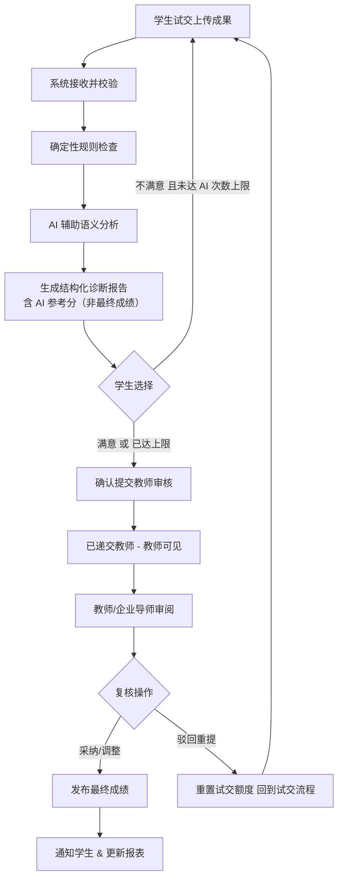

# 衡迹——高校实践教学成果评价与管理平台

## 产品需求规格说明书

---

## 文档信息

| 字段 | 内容 |
|------|------|
| **文档编号** | PRD-HJ-001 |
| **文档名称** | 衡迹产品需求规格说明书 |
| **产品名称** | 衡迹——高校实践教学成果评价与管理平台 |
| **产品代号** | B1（内部研发代号，对外以「衡迹」为准） |
| **文档版本** | V2.5 |
| **文档状态** | 正式发布 |
| **编制日期** | 2026-08-23 |
| **密级** | 内部公开 |
| **适用阶段** | 产品化 / 软著登记 / 功能自检 / 持续迭代 |

### 版本历史

| 版本 | 日期 | 修订内容 | 变更原因 |
|------|------|----------|----------|
| V2.5 | 2026-09-24 | 明确 **响应式 Web 须支持手机 / 平板 / 桌面**；更新客户端分辨率与兼容性 NFR；原生 App 仍为 E-06 远期 | 移动端适配纳入产品范围 |
| V2.4 | 2026-08-24 | 定稿各角色顶部导航信息架构（IA）；合并重复入口为 Tab 分区页 | 导航精简与文档补齐 |
| V2.3 | 2026-08-23 | 采用方案 A：试交 + 确认提交两阶段；AI 参考分非最终成绩；试交教师不可见；AI 次数教师可配默认 3；驳回重置 AI 次数 | 成果提交流程定稿 |
| V2.2 | 2026-08-23 | 明确一账号一角色；删除多角色切换；同一人多职责须分别建号 | 产品规则定稿 |
| V2.1 | 2026-08-23 | 确定产品名称为「衡迹」；恢复企业角色；登录自动判别；四维度通用版；第 12 章自测手册 | 产品化定稿 |
| V2.0 | 2026-08-23 | 全新编制；面向高校全专业实践教学场景；明确 AI 人在回路原则；将领域自研模型列为后续研究方向 | 竞赛结束后的产品化需求 |
| V1.0 | 2026-07-18 | 竞赛期初始版本（已废止） | 竞赛期需求基线 |

### 文档约定

本文档采用 GB/T 9385-2008《计算机软件需求规格说明规范》的表述约定：

| 用语 | 含义 |
|------|------|
| **必须** | 强制性要求，不满足则视为需求未实现 |
| **应** | 推荐性要求，原则上应实现；若偏离须在变更记录中说明理由 |
| **可** | 可选要求，根据资源与阶段择机实现 |
| **禁止** | 明确不允许的行为或设计 |

---

## 1 引言

### 1.1 编写目的

本文档旨在定义 **衡迹——高校实践教学成果评价与管理平台**（以下简称「本系统」或「衡迹」）的产品目标、功能边界、业务规则、非功能指标、验收标准及用户操作说明，作为产品设计、研发、测试、部署、运维、软著登记与功能自检的统一基线。

本文档为独立编制的 V2.1 版本，在继承既有技术架构与实现成果的基础上，对产品命名、角色体系、登录方式及评价框架策略进行了修订。

### 1.2 文档范围

本文档覆盖：

- 产品定位、用户角色、业务流程与系统边界；
- 功能需求（含优先级 P0 / P1 / P2）；
- 非功能需求（性能、安全、合规、可用性等）；
- 数据需求与外部接口需求；
- AI 能力需求、约束及后续研究方向；
- 验收标准；
- **用户操作手册与功能自检清单**（第 12 章，供开发与测试人员使用）。

本文档**不包含**：

- 详细接口字段定义（见 `docs/04-API-Contract.md`）；
- 数据库物理设计细节（见 `docs/03-Database-Design.md`）；
- UI 视觉规范细节（见 `docs/02-UI-Design-System.md`）；
- 领域自研大模型的训练实现细节（列为后续研究方向，见第 8.4 节）。

### 1.3 读者对象

| 读者 | 关注章节 |
|------|----------|
| 产品经理 / 项目负责人 | 全文 |
| 研发工程师（前端 / 后端） | 第 3～8 章、第 12 章 |
| 测试工程师 / 自测人员 | 第 4～5 章、第 9 章、**第 12 章** |
| 运维工程师 | 第 3.7 节、第 5 章、第 7 章、第 12.2 节 |
| 软著申报人员 | 第 1～2 章、第 4 章、第 9 章、第 11.3 节 |
| 高校教务 / 业务方 | 第 2 章、第 4 章、第 12 章 |

### 1.4 术语与缩略语

| 术语 / 缩略语 | 全称与释义 |
|---------------|------------|
| 衡迹 | 本系统正式产品名称 |
| B1 | 本系统内部研发代号 |
| PRD / SRS | 产品需求文档 / 软件需求规格说明书 |
| 实践教学 | 高校人才培养方案中的实验、实训、课程设计、毕业设计、社会调查、创新创业实践等实践性教学环节 |
| 实践成果 | 学生在实践教学环节中提交的各类作品，包括但不限于报告、论文、设计稿、代码、数据文件、多媒体作品等 |
| OBE | 成果导向教育（Outcome-Based Education） |
| RBAC | 基于角色的访问控制（Role-Based Access Control） |
| JWT | JSON Web Token，用于无状态身份认证 |
| LLM | 大语言模型（Large Language Model） |
| AI 辅助分析 | 系统调用大模型或规则引擎对实践成果进行检查、诊断并生成结构化建议，**不直接作为最终成绩** |
| 人在回路（Human-in-the-Loop） | 教师或企业导师对 AI 分析结果进行审核、采纳、驳回或调整后，方可发布正式成绩 |
| 四维度评价框架 | 系统固定的四维能力评价基线，当前版本统一使用通用维度名称 |
| R/S/R/O | 任务级评分细则结构：Role（角色定位）、Skill（能力要点）、Rule（检查规则）、Output（输出格式约束） |
| Provider | 对外部能力（如 LLM、对象存储）的抽象接口实现 |
| MVP | 最小可行产品（Minimum Viable Product） |
| P0 / P1 / P2 | 需求优先级：P0 为当前版本必须实现；P1 为重要迭代；P2 为远期规划 |
| RAG | 检索增强生成（Retrieval-Augmented Generation） |
| SSE | Server-Sent Events，服务端推送事件流 |

### 1.5 参考资料

**国家标准与行业规范：**

- GB/T 9385-2008《计算机软件需求规格说明规范》
- GB/T 8567-2006《计算机软件文档编制规范》
- GB/T 25000.51-2016《系统与软件工程 系统与软件质量要求和评价（SQuaRE）第 51 部分：就绪可用软件产品的质量要求》
- GB/T 22239-2019《信息安全技术 网络安全等级保护基本要求》（参考）
- GB/T 35273-2020《信息安全技术 个人信息安全规范》（参考）

**法律法规（参考）：**

- 《中华人民共和国网络安全法》
- 《中华人民共和国数据安全法》
- 《中华人民共和国个人信息保护法》

**教育政策（参考）：**

- 教育部《教育信息化 2.0 行动计划》
- 《教育部关于加快建设高水平本科教育全面提高人才培养能力的意见》
- 中国工程教育专业认证协会（CEEAA）工程教育认证通用标准

**项目内部文档：**

- `docs/03-Database-Design.md` — 数据库设计
- `docs/04-API-Contract.md` — 接口契约
- `docs/05-Deployment-Guide.md` — 部署指南
- `docs/engineering/ADR-011-Role-System-Simplification.md` — 角色体系决策
- `docs/engineering/ADR-012-Grading-Rule-Fusion.md` — 评分细则融合决策

---

## 2 产品概述

### 2.1 产品定位（一句话）

> **衡迹是面向高校全专业实践教学场景的智能化成果检查、评价与报表管理平台，通过可配置评价标准与大模型辅助分析、教师（及企业导师）复核确认，实现实践教学成果评价的标准化、可追溯与数据化。**

### 2.2 产品愿景

打造一套适用于高校各学科门类及校企协同实践基地的成果管理与智能评价基础设施，使教师与企业导师从重复性批改工作中解放出来，使学生在实践反馈中持续成长，使教学管理者基于数据开展教学质量监控与持续改进。

### 2.3 建设背景与问题陈述

#### 2.3.1 行业痛点

高校实践教学覆盖理工、人文、社科、艺术、经管、医学等多个学科门类，学生需提交形式多样、评价标准各异的实践成果。校企协同实训基地同样面临成果审核标准不一、反馈滞后等问题。当前普遍存在：

| 痛点 | 具体表现 |
|------|----------|
| 评价效率低 | 教师/导师需逐份审阅成果材料，大班教学下单次批改周期常超过一周 |
| 评价标准不统一 | 校内不同教师、校企双方评分尺度差异大，同批次成果评分方差高 |
| 反馈滞后 | 学生难以及时获得结构化、可操作的改进建议 |
| 数据难沉淀 | 成绩统计依赖人工整理，难以支撑教学质量分析与归档 |
| 跨专业难复用 | 传统系统多面向单一学科，难以覆盖全专业实践场景 |

#### 2.3.2 建设契机

- 国家持续推进教育数字化战略，鼓励人工智能赋能教育教学；
- 高校普遍推进成果导向教育（OBE）与教学质量保障体系建设；
- 校企合作实训规模扩大，亟需兼顾教学要求与企业用人标准的评价工具；
- 大语言模型技术成熟，可在可控边界内辅助多类型成果的分析与诊断。

### 2.4 产品目标

| 编号 | 目标 | 可量化指标（参考） |
|------|------|-------------------|
| G-01 | 建立实践教学评价业务闭环 | 覆盖「任务发布 → 试交与 AI 分析 → 学生确认提交 → 教师复核 → 成绩发布 → 报表统计」全流程 |
| G-02 | 提升批改效率 | 教师及企业导师事务性检查工作量降低 60% 以上 |
| G-03 | 缩短评价反馈周期 | 单次实践任务批改周期从平均 7 天降至 2 天以内 |
| G-04 | 统一评价框架 | 建立固定四维度评价基线，同批次评分方差缩小 50% 以上 |
| G-05 | 支撑跨专业能力扩展 | 平台流程与评价配置与具体学科解耦，支持多类型成果提交与分析 |
| G-06 | 保障评价合规与可追溯 | AI 仅提供建议，最终成绩须经人工确认；关键操作全程留痕 |
| G-07 | 支撑校企协同评价 | 企业导师可参与实训成果审核与企业侧评分确认 |

### 2.5 适用范围

#### 2.5.1 适用机构

- 本科院校、高职院校；
- 继续教育学院、实践教学中心；
- 校企协同实践基地、企业培训中心。

#### 2.5.2 适用教学场景

| 场景类型 | 示例 |
|----------|------|
| 课程实验 | 物理实验报告、化学实验记录、编程实验 |
| 课程设计 | 工程设计、方案设计、作品设计 |
| 专业实训 | 软件实训、会计模拟实训、护理技能实训 |
| 毕业设计 | 毕业论文、毕业作品、综合实践报告 |
| 创新创业实践 | 商业计划书、项目路演材料 |
| 校企实训 | 企业项目实战成果、岗位技能考核作品 |

#### 2.5.3 适用用户角色

见第 3.2 节。

### 2.6 排除范围

| 编号 | 排除项 | 说明 |
|------|--------|------|
| E-01 | 在线课程视频播放 | 非 LMS 全功能平台 |
| E-02 | 学分 / 学籍管理 | 不与教务核心系统深度耦合 |
| E-03 | 在线支付与收费 | 非商业化计费系统 |
| E-04 | 第三方教学平台深度集成 | 如超星、智慧树等（可预留接口） |
| E-05 | 领域自研大模型训练与部署 | 列为后续研究方向，见第 8.4 节 |
| E-06 | 移动端原生 App（iOS / Android 独立客户端） | P2 远期规划；**不含**响应式 Web，后者须支持 |

---

## 3 总体描述

### 3.1 业务场景

#### 3.1.1 课程实验报告评价（经管类）

某高校《管理学原理》课程要求学生提交市场调研报告（Word/PDF）。教师发布任务并配置 R/S/R/O 评分细则，学生上传报告后，系统对文档结构与论证逻辑进行 AI 辅助分析，教师审核确认后发布成绩。

#### 3.1.2 工科课程设计评价

某高校《机械设计基础》课程要求学生提交设计说明书与图纸（ZIP/PDF）。系统对文档完整性、方案合理性进行辅助分析，教师结合 AI 建议完成复核。

#### 3.1.3 计算机专业代码实训评价

某高校《Java 程序设计》实训要求学生提交代码包或 Git 仓库地址。系统执行静态规则检查与 LLM 语义分析，输出结构化扣分建议，教师逐项采纳或调整后确认成绩。

#### 3.1.4 校企协同实训评价

某软件企业与高校联合开展项目实训。企业导师通过系统查看学员成果与 AI 诊断报告，参与企业侧评分确认；授课教师进行教学侧复核，双方评分均留痕可追溯。

### 3.2 用户角色与权限

本系统采用 **RBAC 权限模型**，平台共定义五种角色类型；**每个用户账号仅绑定其中一种角色**（见第 3.2.1 节）。

| 角色 | 角色编码 | 职责范围 |
|------|----------|----------|
| **学生** | `STUDENT` | 查看课程与任务、提交实践成果、查看 AI 诊断报告与成绩、查看个人成长数据 |
| **授课教师** | `TEACHER` | 管理课程与任务、配置任务级评分细则、审阅 AI 报告并确认成绩、查看班级/学院级报表、管理课程资料；**兼担原教研负责人职能**（跨班级统计、教学质量分析） |
| **企业导师** | `ENTERPRISE_MENTOR` | 参与校企实训任务审核、查看学员成果与 AI 诊断报告、确认企业侧评分、查看实训基地相关报表 |
| **企业培训管理员** | `ENTERPRISE_ADMIN` | 管理企业实训基地与培训班、配置企业评价标准、查看企业培训效果报表、学员能力追踪 |
| **系统管理员** | `ADMIN` | 用户与角色管理、班级管理、系统参数配置、运行监控、操作日志审计 |

#### 3.2.1 一账号一角色与登录

**基本原则：**

- 每个用户账号**有且仅有一个**角色；
- 系统**不提供**登录后切换角色、主角色或多身份工作台；
- 若同一人现实中承担多种职责（例如既任课又负责系统运维），须由管理员为其**每种职责分别创建独立账号**（如教师账号 + 管理员账号），各自使用对应账号登录。

| 编号 | 规则 |
|------|------|
| AUTH-01 | 用户登录时**仅需输入账号与密码**，**禁止**在登录页手动选择身份/角色 |
| AUTH-02 | 系统必须根据该账号绑定的**唯一角色**自动判别身份 |
| AUTH-03 | 登录成功后，系统必须自动跳转至该角色对应的默认工作台 |
| AUTH-04 | 每个用户账号**必须且只能**绑定一个角色；禁止为一个账号分配多个角色 |
| AUTH-05 | 系统**禁止**提供登录后角色切换、主角色或多工作台切换功能 |
| AUTH-06 | 系统必须校验账号角色与访问路由的匹配关系，禁止越权访问 |

#### 3.2.2 权限原则

- 系统必须实现角色级功能隔离与数据隔离；
- 学生仅可访问本人数据；教师仅可访问其授课班级相关数据；企业角色仅可访问授权范围内的实训基地/培训班数据；管理员按授权范围管理；
- 禁止垂直越权与水平越权。

### 3.3 业务流程

#### 3.3.1 核心业务闭环

```
课程管理 → 任务发布 → 细则配置 → 试交与 AI 分析 → 学生确认提交 → 教师复核 → 成绩发布 → 报表统计
```

#### 3.3.2 成果评价流程（方案 A：试交 + 确认提交）

采用**两阶段递交**：试交阶段学生可多次上传并获取 AI 诊断（教师不可见）；学生满意后须点击**「确认提交教师审核」**，方视为完成任务并进入教师待复核队列。



**截止规则：**

- 任务完成标志 = 截止前完成**确认提交**；仅试交、仅完成 AI 分析**不算**完成任务。
- 截止时间到达时，若学生**从未确认提交**，状态记为**未完成**；系统**不**自动将末次试交版本递交教师。
- 截止后是否给予补交机会，由教师决定是否**延长截止时间**；延长后学生须重新走试交 → 确认提交流程。

#### 3.3.3 提交状态定义

| 状态 | 编码 | 学生可见 | 教师可见 | 说明 |
|------|------|----------|----------|------|
| 草稿试交 | `DRAFT` | 是 | **否** | 已上传，待或正在触发 AI |
| AI 分析中 | `ANALYZING` | 是 | **否** | 异步分析进行中 |
| 待学生确认 | `AI_READY` | 是 | **否** | 报告就绪，含 **AI 参考分** |
| 已递交教师 | `CONFIRMED` | 是 | **是** | 学生已确认，锁定当前版本 |
| 教师复核中 | `REVIEWING` | 是 | 是 | 教师正在复核 |
| 已发布 | `PUBLISHED` | 是 | 是 | 教师已发布最终成绩 |
| 未完成 | `INCOMPLETE` | 是 | 是（统计） | 截止前未确认提交 |

#### 3.3.4 试交与确认规则

| 编号 | 规则 |
|------|------|
| SUB-01 | **试交阶段**教师端**不可见**学生成果、AI 报告及 AI 参考分 |
| SUB-02 | 每次试交上传（含重传）触发一次 AI 分析，计入该任务的 **AI 分析次数** |
| SUB-03 | 每任务 AI 分析次数上限由教师在发布任务时配置，**默认 3 次** |
| SUB-04 | AI 次数用尽后，学生**仍须**能够基于**最后一次**试交结果执行「确认提交教师审核」，不得因次数用尽而无法交作业 |
| SUB-05 | **确认提交**每轮仅允许 **1 次**；确认后学生**不可自行修改**，须联系教师**驳回重提** |
| SUB-06 | 教师**驳回重提**后，该生该任务的 **AI 分析次数重置**为任务配置值（默认 3 次），重新进入试交流程 |
| SUB-07 | 学生端提供**轻量时间线**，展示试交次数、各次 AI 参考分及确认提交记录；**教师仅查看确认提交的最终版本** |
| SUB-08 | **AI 参考分**必须在界面明示「仅供参考，非最终成绩；最终成绩以教师评定为准」 |

#### 3.3.5 AI 评价原则（必须遵守）

| 编号 | 原则 | 说明 |
|------|------|------|
| AI-01 | AI 仅提供建议 | 系统禁止将 AI 输出直接作为最终成绩发布 |
| AI-02 | 人工拥有最终决定权 | 所有成绩发布须经教师或授权导师确认 |
| AI-03 | 结果可解释 | 每条 AI 建议须附带依据、维度归属及置信度（如适用） |
| AI-04 | 结果可追溯 | 保留 AI 原始输出、人工修改记录及发布时间 |
| AI-05 | 分层分析降幻觉 | 确定性规则优先，LLM 用于语义层分析 |
| AI-06 | AI 参考分非最终成绩 | 诊断报告中的 `overall_score` 仅作 AI 参考分展示，不得作为任务完成成绩或最终成绩 |

### 3.4 系统边界

#### 3.4.1 系统内

- 用户认证与权限管理（含自动角色判别）；
- 课程、班级、任务管理；
- 成果提交与文件存储；
- 评价标准与任务级细则管理；
- AI 辅助分析与诊断报告生成；
- 教师 / 企业导师复核与成绩管理；
- 统计报表与数据导出；
- 系统运维与审计。

#### 3.4.2 系统外

| 外部系统 / 服务 | 交互方式 | 说明 |
|-----------------|----------|------|
| 大语言模型 API | HTTPS | 当前版本通过 OpenAI Compatible 协议调用第三方 LLM |
| 多模态大模型 API | HTTPS | 用于图片 / 设计稿类成果分析 |
| 对象存储（MinIO） | S3 协议 | 成果文件存储 |
| 关系型数据库（MySQL） | JDBC | 业务数据持久化 |
| 缓存（Redis） | Redis 协议 | 会话、缓存、队列 |
| 校园统一身份认证 | CAS / OAuth2（P1） | 可选对接 |
| 教务管理系统 | 数据导入（P1） | 可选对接 |

### 3.5 系统架构概述

本系统采用 **前后端分离的 B/S 架构**，后端为 **模块化单体**（Spring Boot），前端为 **SPA**（Vue 3）。

```
┌─────────────────────────────────────────────────────────┐
│                    客户端（浏览器）                        │
│              Vue 3 + TypeScript + Element Plus           │
└────────────────────────┬────────────────────────────────┘
                         │ HTTPS / RESTful JSON
┌────────────────────────▼────────────────────────────────┐
│                  应用服务层（Spring Boot）                 │
│  ┌─────────┬─────────┬──────────┬─────────┬──────────┐  │
│  │  Auth   │ Course  │ Training │Submission│   AI    │  │
│  ├─────────┼─────────┼──────────┼─────────┼──────────┤  │
│  │ Review  │ Report  │  File    │  User   │  Admin   │  │
│  └─────────┴─────────┴──────────┴─────────┴──────────┘  │
│              事件驱动：SubmissionCompletedEvent → AI       │
└──────┬──────────────┬──────────────┬────────────────────┘
       │              │              │
   ┌───▼───┐     ┌────▼────┐    ┌────▼────┐
   │ MySQL │     │  Redis  │    │  MinIO  │
   └───────┘     └─────────┘    └─────────┘
                         │
                   ┌─────▼─────┐
                   │ LLM API   │  （DeepSeek / Qwen 等）
                   └───────────┘
```

> 详细架构见 `docs/03-Database-Design.md` 与 `docs/04-API-Contract.md`。

### 3.6 技术架构概述

| 层级 | 技术选型 |
|------|----------|
| 前端 | Vue 3、TypeScript、Vite、Pinia、Vue Router、Element Plus、ECharts |
| 后端 | Spring Boot 3、Spring Security、MyBatis Plus、JDK 21 |
| 数据 | MySQL 8.0+、Redis、MinIO |
| AI | OpenAI Compatible API（DeepSeek 默认；Qwen 用于多模态场景） |
| 部署 | Docker、Docker Compose |
| 文档 | Knife4j（OpenAPI 3.0） |

### 3.7 运行环境与部署约束

#### 3.7.1 服务端最低配置

| 资源 | 要求 |
|------|------|
| CPU | 4 核及以上 |
| 内存 | 16 GB 及以上 |
| 磁盘 | 100 GB 及以上（含成果文件存储） |
| 操作系统 | Linux（Ubuntu 20.04+ / CentOS 7+）或容器化环境 |
| 数据库 | MySQL 8.0+ |
| 容器 | Docker 20.10+（推荐） |

#### 3.7.2 客户端要求

| 项目 | 要求 |
|------|------|
| 浏览器 | Chrome 90+、Edge 90+、Firefox 88+、**iOS Safari / Android Chrome**（各最新两个大版本） |
| 形态 | **响应式 Web**：手机、平板、桌面浏览器均可访问；原生 App 见 E-06 |
| 分辨率 | 手机逻辑宽 **≥375px** 须可用；平板 ≥768px；桌面推荐 1920×1080，**≥1280×720** 完整桌面体验 |
| 网络 | 校园网或专线；AI 分析功能需可访问 LLM API |

### 3.8 假设与依赖

| 编号 | 假设 / 依赖 |
|------|-------------|
| A-01 | 用户具备基本的信息化操作能力 |
| A-02 | 学校或企业提供稳定的网络与服务器资源 |
| A-03 | 第三方 LLM API 在合同期内可用且满足基本 SLA |
| A-04 | 教师与企业导师具备本专业实践评价的基本能力与权威 |
| A-05 | 管理员为用户创建账号时，每人仅分配一个角色；一人多职责通过多账号实现 |

### 3.9 约束条件

| 编号 | 约束 |
|------|------|
| C-01 | AI 分析任务必须异步执行，不得阻塞用户提交请求 |
| C-02 | 涉及学生个人信息的处理须符合个人信息保护相关要求 |
| C-03 | 成果文件大小须受系统配置上限约束（默认单文件 ≤ 50 MB） |
| C-04 | 系统须支持私有化部署，数据存储于使用方可控环境 |

---

## 4 功能需求

### 4.1 功能总览与优先级

| 模块编号 | 模块名称 | 功能概述 | 优先级 |
|----------|----------|----------|--------|
| M-01 | 用户认证与权限 | 账号密码登录、自动角色判别、JWT 鉴权、RBAC | P0 |
| M-02 | 课程管理 | 课程创建、编辑、归档、班级关联 | P0 |
| M-03 | 实训任务管理 | 任务发布、截止时间、提交规则配置 | P0 |
| M-04 | 评价标准与细则 | 四维度通用基线 + 任务级 R/S/R/O 细则 | P0 |
| M-05 | 成果提交 | 多格式文件上传、Git 地址提交（可选） | P0 |
| M-06 | 智能分析引擎 | 规则检查 + AI 辅助分析 + 结构化报告 | P0 |
| M-07 | 复核工作台 | 教师/企业导师审阅、采纳/驳回/调整、成绩发布 | P0 |
| M-08 | 成绩与报表 | 个人/班级/学院/企业报表、PDF/Excel 导出 | P0 |
| M-09 | 学生成长中心 | 成绩趋势、能力雷达、成长时间线 | P0 |
| M-10 | 系统管理 | 用户、班级、配置、日志、监控 | P0 |
| M-11 | 企业实训管理 | 企业基地、培训班、企业侧评价配置 | P1 |
| M-12 | 知识库 | 课程资料管理、检索增强（RAG） | P1 |
| M-13 | 通知中心 | 任务提醒、成绩发布通知 | P1 |
| M-14 | 统一身份认证对接 | CAS / OAuth2 校园认证 | P1 |
| M-15 | 专业评价配置 | 按专业自定义四维度名称与评判标准 | P1 |
| M-16 | 多 Agent 协作分析 | 需求对照、安全审查、汇总代理 | P1 |
| M-17 | 成果查重 | 文本 / 代码相似度检测 | P2 |
| M-18 | 在线编辑与 IDE 集成 | 在线编写、插件生态 | P2 |

### 4.2 详细功能需求

#### 4.2.1 M-01 用户认证与权限（P0）

| 需求编号 | 需求描述 | 优先级 |
|----------|----------|--------|
| FR-01-01 | 系统必须支持学生、授课教师、企业导师、企业培训管理员、系统管理员五种角色 | P0 |
| FR-01-02 | 系统必须支持账号密码登录 | P0 |
| FR-01-03 | 登录页**禁止**要求用户手动选择角色；系统必须根据账号绑定信息自动判别身份 | P0 |
| FR-01-04 | 登录成功后必须自动跳转至对应角色工作台 | P0 |
| FR-01-05 | 管理员创建或编辑用户时，每个账号**必须且只能**分配一个角色；禁止多角色绑定 | P0 |
| FR-01-06 | 系统必须基于 JWT 实现无状态身份认证 | P0 |
| FR-01-07 | 系统必须对每次 API 请求进行权限校验 | P0 |
| FR-01-08 | 密码必须采用 bcrypt 等安全算法加盐哈希存储 | P0 |
| FR-01-09 | 系统应支持连续登录失败锁定策略 | P1 |
| FR-01-10 | 系统可对接校园统一身份认证（CAS / OAuth2） | P1 |

#### 4.2.2 M-02 课程管理（P0）

| 需求编号 | 需求描述 | 优先级 |
|----------|----------|--------|
| FR-02-01 | 教师必须能够创建课程，填写课程名称、编号、学期等信息 | P0 |
| FR-02-02 | 教师必须能够将课程与授课班级关联 | P0 |
| FR-02-03 | 教师应能够编辑课程信息、归档已结束课程 | P0 |
| FR-02-04 | 学生必须能够查看已选课程列表及课程详情 | P0 |

#### 4.2.3 M-03 实训任务管理（P0）

| 需求编号 | 需求描述 | 优先级 |
|----------|----------|--------|
| FR-03-01 | 教师必须能够创建实践任务，配置名称、描述、截止时间 | P0 |
| FR-03-02 | 教师必须能够配置提交方式（文件上传 / Git 地址 / 组合） | P0 |
| FR-03-03 | 教师必须能够配置每任务 **AI 分析次数上限**（`max_ai_analyze_count`），**默认 3 次** | P0 |
| FR-03-04 | 教师必须能够发布任务，发布后学生端可见 | P0 |
| FR-03-05 | 教师应能够查看学生提交状态（含未完成 / 试交中 / 已确认 / 已发布） | P0 |
| FR-03-06 | 教师应能够延长任务截止时间（含对未完成学生的补交机会） | P1 |
| FR-03-07 | 企业培训管理员应能够为校企实训任务指定企业导师 | P1 |
| FR-03-08 | 学生必须能够在截止时间前完成试交与确认提交 | P0 |

#### 4.2.4 M-04 评价标准与细则（P0）

> 依据 ADR-012：系统固化四维度评价基线；教师在建任务时填写任务级 R/S/R/O 文本细则。

**当前版本策略（V2.1）：**

| 策略项 | 说明 |
|--------|------|
| 四维度名称 | **全平台统一使用通用版**：完成度、规范性、质量、表达与完整性 |
| 维度权重 | 系统配置，默认各 25% |
| 任务级细则 | 教师通过 R/S/R/O 文本描述本专业/本任务的具体评判要求 |
| 后续扩展 | 支持按专业/学院自定义四维度名称及评判标准（见 FR-04-07，P1） |

| 需求编号 | 需求描述 | 优先级 |
|----------|----------|--------|
| FR-04-01 | 系统必须固化四维度评价框架作为统一基线 | P0 |
| FR-04-02 | 当前版本四维度名称必须为：**完成度**、**规范性**、**质量**、**表达与完整性** | P0 |
| FR-04-03 | 教师必须能够在创建任务时填写 Role / Skill / Rule 三段评分细则文本 | P0 |
| FR-04-04 | 系统必须将四维度基线与任务级细则融合后注入 AI 分析 Prompt | P0 |
| FR-04-05 | AI 输出必须按四维度结构返回 JSON，以支撑雷达图与明细追溯 | P0 |
| FR-04-06 | 四维度语义说明须在系统内对用户可见，帮助不同专业理解维度含义 | P0 |
| FR-04-07 | 系统应支持按专业/学院自定义四维度展示名称及评判标准模板 | P1 |
| FR-04-08 | 专业自定义维度不得破坏四维度 JSON 输出结构与雷达图数据结构 | P1 |

**四维度通用语义说明：**

| 维度 | 通用含义 | 跨专业示例 |
|------|----------|------------|
| 完成度 | 任务要求达成程度 | 实验步骤完成、功能实现、方案落地 |
| 规范性 | 格式、流程、规范遵循 | 引用格式、代码规范、设计规范 |
| 质量 | 内容 / 作品本身质量 | 论证深度、代码质量、设计美感 |
| 表达与完整性 | 呈现与文档完整程度 | 报告结构、图表齐全、说明清晰 |

#### 4.2.5 M-05 成果提交（P0）

> 采用**方案 A**：试交（教师不可见）→ 确认提交教师审核（任务完成标志）。

| 需求编号 | 需求描述 | 优先级 |
|----------|----------|--------|
| FR-05-01 | 学生必须能够进行**试交**（上传文件或填写 Git 地址） | P0 |
| FR-05-02 | 系统必须支持常见成果格式：ZIP、PDF、DOC/DOCX、XLS/XLSX、TXT、MD、PNG/JPG 等 | P0 |
| FR-05-03 | 试交阶段教师端**不得**查看学生成果与 AI 分析结果 | P0 |
| FR-05-04 | 系统必须对上传文件进行格式与大小校验 | P0 |
| FR-05-05 | 每次试交须计入 AI 分析次数，且不得超过任务配置的 `max_ai_analyze_count` | P0 |
| FR-05-06 | AI 次数用尽后，学生必须仍能基于**最后一次试交**执行「确认提交教师审核」 | P0 |
| FR-05-07 | 学生必须能够点击「确认提交教师审核」；该操作每轮仅允许 **1 次** | P0 |
| FR-05-08 | **确认提交**成功后，系统须记录确认时间；该时间作为任务完成时间判定依据 | P0 |
| FR-05-09 | 截止时间到达时，若学生从未确认提交，状态须记为 **未完成**；禁止自动递交末次试交 | P0 |
| FR-05-10 | 确认提交后，学生**禁止**自行修改成果；仅可通过教师**驳回重提** | P0 |
| FR-05-11 | 教师驳回重提后，该生该任务 **AI 分析次数须重置**为任务配置值 | P0 |
| FR-05-12 | 学生端须提供**轻量时间线**，展示试交次数与各次 AI 参考分（教师不可见历史试交） | P0 |
| FR-05-13 | 系统应将成果文件存储至对象存储，并记录元数据 | P0 |

#### 4.2.6 M-06 智能分析引擎（P0）

| 层级 | 分析方式 | 特点 |
|------|----------|------|
| L1 确定性规则 | 文件存在性、格式、必填项、目录结构等 | 零幻觉 |
| L2 静态分析 | 代码规范检查（如 Checkstyle，仅适用于代码类成果） | 零幻觉 |
| L3 AI 语义分析 | LLM 对成果内容进行语义理解与评价 | 须人工复核 |

| 需求编号 | 需求描述 | 优先级 |
|----------|----------|--------|
| FR-06-01 | 学生每次试交成功后，系统必须异步触发智能分析任务 | P0 |
| FR-06-02 | 系统必须生成结构化诊断报告，并包含 **AI 参考分**（`overall_score`） | P0 |
| FR-06-03 | 界面必须明示 AI 参考分**非最终成绩**，最终成绩以教师评定为准 | P0 |
| FR-06-04 | 每条扣分项必须包含：维度名称、问题类型、严重程度、建议扣分、原因、改进建议、置信度 | P0 |
| FR-06-05 | 代码类成果应支持定位到文件路径与行号（如适用） | P0 |
| FR-06-06 | 文档类成果应支持定位到章节或段落（如适用） | P0 |
| FR-06-07 | 图片 / 设计稿类成果应支持多模态 AI 分析 | P0 |
| FR-06-08 | AI 分析必须通过 Provider 抽象层调用 | P0 |
| FR-06-09 | AI 分析失败时必须支持自动重试（默认最多 3 次） | P0 |
| FR-06-10 | 系统必须记录 Token 用量与分析耗时 | P0 |
| FR-06-11 | 系统应通过 SSE 或轮询向前端推送分析进度 | P1 |

#### 4.2.7 M-07 复核工作台（P0）

| 需求编号 | 需求描述 | 优先级 |
|----------|----------|--------|
| FR-07-01 | 教师必须能够查看**已确认提交**学生的 AI 诊断报告全文（试交阶段不可见） | P0 |
| FR-07-02 | 教师必须能够逐条审阅 AI 建议：采纳、驳回、调整 | P0 |
| FR-07-03 | 教师必须能够手动添加扣分项 | P0 |
| FR-07-04 | 教师必须能够调整各维度分数及总分 | P0 |
| FR-07-05 | 教师确认后，系统必须发布正式成绩并通知学生 | P0 |
| FR-07-06 | 教师可将已确认提交的成果**驳回重提**；驳回后重置该生 AI 分析次数并回到试交流程 | P0 |
| FR-07-07 | 企业导师应能够查看授权范围内学员的 AI 报告并提交企业侧评分意见 | P1 |
| FR-07-08 | 系统必须记录完整复核日志 | P0 |
| FR-07-09 | 禁止系统在未经人工确认的情况下发布 AI 建议分作为最终成绩 | P0 |

#### 4.2.8 M-08 成绩与报表（P0）

| 需求编号 | 需求描述 | 优先级 |
|----------|----------|--------|
| FR-08-01 | 学生必须能够查看个人成绩单及四维度明细 | P0 |
| FR-08-02 | 学生必须能够查看 AI 诊断报告摘要 | P0 |
| FR-08-03 | 教师必须能够查看班级成绩分布、完成率、各维度平均分 | P0 |
| FR-08-04 | 教师应能够查看跨班级对比与学期趋势分析 | P0 |
| FR-08-05 | 企业培训管理员应能够查看企业实训基地培训效果报表 | P1 |
| FR-08-06 | 系统必须支持导出 PDF 与 Excel 格式报表 | P0 |
| FR-08-07 | 报表数据必须与复核后的正式成绩一致 | P0 |

#### 4.2.9 M-09 学生成长中心（P0）

| 需求编号 | 需求描述 | 优先级 |
|----------|----------|--------|
| FR-09-01 | 学生应能够查看个人成绩趋势图 | P0 |
| FR-09-02 | 学生应能够查看四维度能力雷达图 | P0 |
| FR-09-03 | 学生应能够查看实践成长时间线 | P1 |

#### 4.2.10 M-10 系统管理（P0）

| 需求编号 | 需求描述 | 优先级 |
|----------|----------|--------|
| FR-10-01 | 管理员必须能够管理用户账号（创建、编辑、禁用）；创建/编辑时**每个账号仅可分配一个角色** | P0 |
| FR-10-02 | 管理员必须能够管理班级信息 | P0 |
| FR-10-03 | 管理员必须能够配置系统参数 | P0 |
| FR-10-04 | 管理员必须能够查看操作日志 | P0 |
| FR-10-05 | 管理员应能够查看系统运行监控指标 | P1 |

#### 4.2.11 M-11 企业实训管理（P1）

| 需求编号 | 需求描述 | 优先级 |
|----------|----------|--------|
| FR-11-01 | 企业培训管理员必须能够管理企业实训基地与培训班 | P1 |
| FR-11-02 | 企业培训管理员必须能够配置企业评价标准 | P1 |
| FR-11-03 | 企业培训管理员必须能够为企业导师分配审核权限 | P1 |
| FR-11-04 | 企业导师必须能够查看授权范围内学员的成果与 AI 报告 | P1 |

---

## 5 非功能需求

### 5.1 性能需求

| 编号 | 指标 | 要求 |
|------|------|------|
| NFR-P-01 | 页面首屏加载 | ≤ 2 秒（P95） |
| NFR-P-02 | 页面切换 | ≤ 1 秒 |
| NFR-P-03 | 普通查询接口响应 | ≤ 500 ms（P95） |
| NFR-P-04 | 报表生成 | ≤ 5 秒 |
| NFR-P-05 | AI 分析耗时 | ≤ 120 秒 / 次（P95） |
| NFR-P-06 | 并发在线用户 | ≥ 200 |
| NFR-P-07 | 并发操作 | ≥ 50 |
| NFR-P-08 | 数据容量 | 支持 10 万条以上实践记录 |

### 5.2 可用性与可靠性

| 编号 | 需求 |
|------|------|
| NFR-A-01 | 系统应支持 7×24 小时运行 |
| NFR-A-02 | 单次故障恢复时间 ≤ 30 分钟 |
| NFR-A-03 | AI 分析任务失败不得导致已提交成果数据丢失 |

### 5.3 安全性与合规

| 编号 | 需求 |
|------|------|
| NFR-S-01 | 全链路 HTTPS 加密传输 |
| NFR-S-02 | 密码加盐哈希存储 |
| NFR-S-03 | RBAC 权限控制，防止越权 |
| NFR-S-04 | 输入校验，防范 SQL 注入、XSS、CSRF |
| NFR-S-05 | 敏感数据支持脱敏 |
| NFR-S-06 | 关键操作须记录审计日志 |
| NFR-S-07 | LLM API Key 不得硬编码 |
| NFR-S-08 | 学生成果数据仅授权人员可访问 |
| NFR-S-09 | 个人信息处理须遵循最小必要原则 |
| NFR-S-10 | 向第三方 LLM 传输数据前须评估敏感级别 |

### 5.4 可维护性与可扩展性

| 编号 | 需求 |
|------|------|
| NFR-M-01 | 模块间通过接口与事件通信 |
| NFR-M-02 | LLM 厂商通过 Provider 接口隔离 |
| NFR-M-03 | 配置按环境分离 |
| NFR-M-04 | API 文档通过 OpenAPI 3.0 自动生成 |

### 5.5 易用性

| 编号 | 需求 |
|------|------|
| NFR-U-01 | 核心操作路径不超过 3 步 |
| NFR-U-02 | 登录仅需账号密码，无需选择角色 |
| NFR-U-03 | 表单必填项标红星，校验失败给出明确提示 |
| NFR-U-04 | 危险操作须二次确认 |
| NFR-U-05 | AI 输出须明示「仅供参考，以教师/导师评定为准」 |

### 5.6 兼容性

| 编号 | 需求 |
|------|------|
| NFR-C-01 | 浏览器：Chrome 90+、Edge 90+、Firefox 88+、iOS Safari / Android Chrome（最新两个大版本） |
| NFR-C-02 | 分辨率与形态：桌面 ≥1280×720 完整支持；平板 ≥768px 可用；**手机 ≥375px 须完成学生主路径及教师轻量复核**（布局规范见 UI Design System §6.8–6.9） |
| NFR-C-03 | 服务端支持 Linux 与 Docker 部署 |
| NFR-C-04 | 响应式：统一断点；XS/SM 导航为汉堡 + Drawer；多栏工作台在手机端须降级为 Tab / 分步 / 钻取，禁止整页横向溢出 |

---

## 6 数据需求

### 6.1 核心数据实体

| 实体 | 说明 |
|------|------|
| 用户（User） | 系统账号、基本信息、角色关联 |
| 角色（Role） | 学生 / 教师 / 企业导师 / 企业培训管理员 / 管理员（**每用户账号仅绑定其一**） |
| 课程（Course） | 课程基本信息、学期、授课教师 |
| 班级（Class） | 教学班级、学生归属 |
| 实践任务（TrainingTask） | 任务描述、截止时间、提交规则、评分细则、`max_ai_analyze_count`（默认 3） |
| 提交记录（Submission） | 试交/确认状态、试交次数、确认时间、任务完成状态 |
| 文件存储（FileStorage） | 成果文件元数据与存储路径 |
| 评价标准（EvaluationStandard） | 系统四维度基线 |
| 标准维度（StandardDimension） | 维度名称、权重、满分 |
| AI 分析（AiAnalysis） | 分析状态、结果摘要、Token 统计 |
| AI 分析明细（AiAnalysisDetail） | 分维度扣分项 |
| 教师复核（TeacherReview） | 复核状态、最终成绩 |
| 复核明细（ReviewItem） | 逐项采纳 / 驳回 / 调整记录 |
| 成绩记录（ScoreRecord） | 正式发布成绩 |
| 操作日志（OperationLog） | 审计追溯 |
| 通知（Notification） | 系统消息 |

### 6.2 数据留存与备份

| 编号 | 要求 |
|------|------|
| DR-01 | 业务数据须持久化至 MySQL |
| DR-02 | 成果文件须持久化至对象存储 |
| DR-03 | 关键业务数据删除须逻辑删除并保留审计痕迹 |

### 6.3 数据安全与隐私

| 编号 | 要求 |
|------|------|
| DP-01 | 收集个人信息须出于明确、正当的教学管理目的 |
| DP-02 | 未经授权不得向第三方披露学生成果与成绩 |
| DP-03 | 调用外部 LLM 时须评估是否包含可识别个人身份的信息 |

---

## 7 接口需求

### 7.1 用户界面

| 编号 | 要求 |
|------|------|
| UI-01 | 采用 B/S 架构，浏览器访问 |
| UI-02 | **顶部导航栏**布局；每角色顶栏 **3～5 项**，详情/表单/审核页不进顶栏 |
| UI-03 | 视觉风格：高校教务 / LMS 类产品，Campus Blue 配色体系 |
| UI-04 | 登录页仅展示账号、密码输入，不展示角色选择步骤 |
| UI-05 | 个人中心、知识库（P1）等辅助功能**不得**占用顶栏，须从头像下拉或页面内入口进入 |
| UI-06 | 同一业务域的多个列表页须合并为 **Tab 分区页**，避免顶栏项过多 |

#### 7.1.1 导航设计原则

| 编号 | 原则 |
|------|------|
| NAV-01 | 顶栏仅放**高频主路径**；每角色控制在 **3～5 项** |
| NAV-02 | **详情页、表单页、审核全屏页**不出现在顶栏（`hidden: true` 路由） |
| NAV-03 | 内容重叠的列表页合并为 **Tab 分区页**（顶栏 1 项 → 页内多 Tab） |
| NAV-04 | **个人中心**统一在头像下拉，不占顶栏 |
| NAV-05 | P1 功能（知识库、企业端）默认不进顶栏 |
| NAV-06 | 旧路由可通过 **重定向** 保留书签兼容（如 `/student/reports` → `/student/analytics?tab=reports`） |

#### 7.1.2 各角色顶部导航（定稿）

**学生（3 项）**

| 顶栏 | 路由 | 说明 |
|------|------|------|
| 工作台 | `/student/dashboard` | 待办、临近截止、快捷入口 |
| 实训任务 | `/student/tasks` | 主操作路径：任务列表 → 详情 → 试交/确认 |
| 学情分析 | `/student/analytics` | Tab：**成绩报告** \| **成长轨迹** |

**学生 — 非顶栏页面**

| 路由 | 页面 | 进入方式 |
|------|------|----------|
| `/student/courses` | 我的课程 | 工作台卡片 / 任务页按课程筛选 |
| `/student/courses/:id` | 课程详情 | 课程列表 |
| `/student/tasks/:id` | 任务详情 | 任务列表 |
| `/student/submit/:id` | 试交/确认 | 任务详情 |
| `/student/grades/:id` | 正式成绩 | 任务详情 / 学情分析 |
| `/student/profile` | 个人中心 | 头像下拉 |

**授课教师（4 项）**

| 顶栏 | 路由 | 说明 |
|------|------|------|
| 工作台 | `/teacher/dashboard` | 待复核、截止提醒、快捷操作 |
| 课程与任务 | `/teacher/teaching` | Tab：**课程** \| **实训任务** \| **提交进度** |
| 审核工作台 | `/teacher/submissions` | 全宽布局；仅已确认提交 |
| 数据报表 | `/teacher/reports` | Tab：**班级报告** \| **学院报告** |

**教师 — 非顶栏页面**

| 路由 | 页面 | 进入方式 |
|------|------|----------|
| `/teacher/knowledge-base` | 知识库（P1） | 课程详情内入口（规划） |
| `/teacher/profile` | 个人中心 | 头像下拉 |

**系统管理员（4 项）**

| 顶栏 | 路由 | 说明 |
|------|------|------|
| 系统总览 | `/admin/dashboard` | 用户规模、服务健康 |
| 组织管理 | `/admin/organization` | Tab：**用户管理** \| **班级管理** |
| 运维中心 | `/admin/operations` | Tab：**运行监控** \| **操作日志** |
| 系统配置 | `/admin/system` | 学期、上传限制、AI 开关 |

**管理员 — 非顶栏页面**

| 路由 | 页面 | 进入方式 |
|------|------|----------|
| `/admin/profile` | 个人中心 | 头像下拉 |

**企业端（P1 规划，未实现）**

| 角色 | 建议顶栏（4 项） |
|------|------------------|
| 企业导师 | 工作台、学员成果、审核评分、实训报表 |
| 企业培训管理员 | 工作台、培训班、导师管理、培训报表 |

#### 7.1.3 页面规模

| 端 | 顶栏项数 | 主要 Tab 分区页 | 状态 |
|----|----------|-----------------|------|
| 公共 | — | 登录、403、404 | 已实现 |
| 学生端 | 3 | 学情分析 | 已实现 |
| 教师端 | 4 | 课程与任务、数据报表 | 已实现 |
| 管理员端 | 4 | 组织管理、运维中心 | 已实现 |
| 企业端 | 4（规划） | — | P1 规划 |

### 7.2 通信接口

| 编号 | 要求 |
|------|------|
| IF-01 | 前后端通过 RESTful HTTP + JSON 通信 |
| IF-02 | 统一响应结构：`{ success, code, message, data, traceId }` |
| IF-03 | 认证方式：Bearer Token（JWT） |

### 7.3 外部接口

| 接口 | 协议 | 用途 | 阶段 |
|------|------|------|------|
| LLM Chat Completions API | HTTPS + JSON | 文本 / 代码语义分析 | P0 |
| 多模态 LLM API | HTTPS + JSON | 图片 / 设计稿分析 | P0 |
| MinIO S3 API | HTTPS | 文件存储 | P0 |
| 校园统一身份认证 | CAS / OAuth2 | 单点登录 | P1 |

---

## 8 AI 能力需求与约束

### 8.1 AI 能力定位

本系统的 AI 能力定位为 **「辅助评审助手」**，而非「自动阅卷系统」。

### 8.2 当前实现方案（V2.1 基线）

| 项目 | 说明 |
|------|------|
| 调用方式 | 通过 `AiProvider` 抽象层，调用第三方 LLM API |
| 默认文本模型 | DeepSeek（OpenAI Compatible 协议） |
| 多模态模型 | Qwen-VL（用于图片 / 截图类成果） |
| 分析模式 | 异步任务 + 结构化 JSON 输出 |

### 8.3 AI 输出规范

AI 分析结果必须遵循系统固定的 JSON 结构（字段定义见第 8.2 节关联的 `PromptBuilder` 实现），四维度名称当前统一为：完成度、规范性、质量、表达与完整性。

### 8.4 后续研究方向（不在 V2.1 基线范围内）

| 编号 | 研究方向 | 说明 |
|------|----------|------|
| R-01 | 领域数据集建设 | 基于教师复核数据构建跨学科评审数据集 |
| R-02 | 领域模型微调 | 基于开源大模型进行 SFT / LoRA 微调 |
| R-03 | 小模型训练实践 | 借鉴 MiniMind 等方法论，探索轻量级专用模型 |
| R-04 | 私有化模型部署 | 通过 vLLM / Ollama 部署，接入 `AiProvider` |
| R-05 | RAG 知识库增强 | 结合课程资料提升分析准确性 |
| R-06 | 多学科 Agent 路由 | 按成果类型自动选择专用分析 Agent |

---

## 9 验收标准

### 9.1 功能验收

| 编号 | 准则 |
|------|------|
| AC-01 | 所有 P0 功能需求必须 100% 实现且通过测试 |
| AC-02 | 核心业务闭环可端到端演示：试交 → AI 参考分 → 确认提交 → 教师复核 → 成绩发布 |
| AC-03 | 登录无需选择角色；一账号一角色，自动跳转对应工作台 |
| AC-04 | 试交阶段教师不可见；仅确认提交后教师可见 |
| AC-05 | 截止前未确认提交记为未完成；不自动递交末次试交 |
| AC-06 | 权限边界清晰，无越权漏洞 |
| AC-07 | 未经教师确认不得发布最终成绩；AI 参考分须标注非最终成绩 |
| AC-08 | 驳回重提后 AI 分析次数正确重置 |
| AC-09 | 第 12 章功能自检清单执行通过率 ≥ 95%（P0 项必须 100%） |

### 9.2 非功能验收

| 编号 | 准则 |
|------|------|
| AC-10 | 禁止为一个账号绑定多个角色；系统不提供登录后角色切换 |
| AC-11 | 性能指标满足第 5.1 节要求 |
| AC-12 | 安全项满足第 5.3 节要求 |
| AC-13 | 连续运行 72 小时无崩溃、无数据丢失 |

---

## 10 风险与待确认事项

### 10.1 风险登记

| 编号 | 风险 | 缓解措施 |
|------|------|----------|
| RISK-01 | 第三方 LLM API 不可用 | Provider 抽象 + 多厂商备选 |
| RISK-02 | AI 输出幻觉 | 人在回路 + 置信度标注 |
| RISK-03 | 学生成果含敏感信息外传 | 数据分级 + 私有化部署 |
| RISK-04 | 跨专业 AI 质量不均 | 任务级细则 + 后续领域微调 |
| RISK-05 | 企业端功能尚未实现 | P1 迭代开发，当前以高校三方角色为主 |

### 10.2 待确认事项

| 编号 | 待确认项 | 状态 |
|------|----------|------|
| Q-01 | 产品正式名称 | ✅ 已确认：衡迹 |
| Q-02 | 四维度策略 | ✅ 当前通用版；专业自定义为 P1 |
| Q-03 | 登录方式 | ✅ 自动判别角色，登录页不选身份 |
| Q-04 | 校园统一身份认证方案 | 待定 |
| Q-05 | 软著登记全称 | ✅ 建议：衡迹高校实践教学成果评价与管理平台 V1.0 |
| Q-06 | 著作权人信息 | 待定 |

---

## 11 附录

### 11.1 需求追溯矩阵（摘要）

| 产品目标 | 关联模块 | 关联需求 |
|----------|----------|----------|
| G-01 业务闭环 | M-01～M-10 | FR-03、FR-05、FR-06、FR-07、FR-08 |
| G-04 统一框架 | M-04 | FR-04 |
| G-05 跨专业扩展 | M-04、M-05、M-06 | FR-04-07、FR-05-02 |
| G-07 校企协同 | M-07、M-11 | FR-07-07、FR-11 |

### 11.2 软著登记信息

| 字段 | 内容 |
|------|------|
| **软件全称** | 衡迹高校实践教学成果评价与管理平台 V1.0 |
| **软件简称** | 衡迹 |
| **版本号** | V1.0 |
| **软件分类** | 应用软件 |
| **运行平台** | Windows / Linux + 浏览器 |

---

## 12 用户操作手册与功能自检

> **本章用途**：供开发人员、测试人员及产品负责人进行功能验证与回归自检。按角色列出操作路径，并在每节附「自检清单」供勾选。

### 12.1 运行环境与启动

#### 12.1.1 环境要求

| 项目 | 要求 |
|------|------|
| 操作系统 | Windows 10/11、macOS 或 Linux |
| 浏览器 | Chrome 90+ 或 Edge 90+（推荐）；手机可用系统浏览器 |
| 分辨率 | 桌面 1366×768 及以上；**手机自检建议 375px 宽** |
| 网络 | 本地开发需同时启动前后端；AI 功能需配置 LLM API Key |

#### 12.1.2 本地启动步骤

**后端（Spring Boot）：**

```bash
cd server
# 配置数据库、Redis、MinIO 及 DEEPSEEK_API_KEY 等环境变量
./mvnw spring-boot:run
```

**前端（Vue 3）：**

```bash
cd B1_Platform
npm install
npm run dev
```

**访问地址：** 浏览器打开 `http://localhost:5173`（以实际 Vite 端口为准）

#### 12.1.3 自检清单（环境）

| 序号 | 检查项 | 预期结果 | 通过 |
|------|--------|----------|------|
| E-01 | 后端服务正常启动，无报错 | 控制台输出 Spring Boot 启动成功 | ☐ |
| E-02 | 前端 dev server 正常启动 | 浏览器可访问登录页 | ☐ |
| E-03 | 数据库迁移脚本已执行 | 测试账号可登录 | ☐ |
| E-04 | LLM API Key 已配置（测 AI 功能时） | AI 分析可触发 | ☐ |

---

### 12.2 测试账号

> 以下账号来自 Flyway `V21__canonical_multi_college_seed.sql`，密码均为 **`123456`**（`admin` 密码见 V2 种子：`admin123`）。

#### 管理员

| 用户名 | 角色 | 用途 |
|--------|------|------|
| `admin` | 管理员 | 用户/班级/日志/系统配置 |

#### 四学院闭环（每学院 1 教师 + 若干学生）

| 学院 | 教师 | 学生（示例） | 课程 | 待审核账号 | 成果形态 |
|------|------|--------------|------|------------|----------|
| 计算机学院 | `teacher1` 张教授 | `student1` 李明（已发布）、`student2` 王芳（**待审**）、`student3` 赵强（驳回）、`student4` 孙丽（在线代码待确认） | Java Web 开发 | `student2` | ZIP + MD + PNG / 在线 Java |
| 经济管理学院 | `teacher2` 陈副教授 | `student5` 周杰（已发布）、`student6` 吴敏（**待审**）、`student7` 郑浩（待确认） | 管理学原理 | `student6` | PDF + Word + Markdown |
| 机械工程学院 | `teacher3` 刘讲师 | `student8` 钱雪（已发布）、`student9` 韩磊（**待审**）、`student10` 林涛 | 机械设计基础 | `student9` | ZIP + MD + PNG |
| 校企合作基地 | `teacher4` 王导师 | `student11` 陈实训（已发布）、`student12` 刘实训（**待审**） | 校企联合项目实训 | `student12` | ZIP + PDF + MD |

> **提交方式说明**：平台支持 **文件上传**（ZIP / PDF / Word / Markdown / 图片）与 **在线代码**；**不支持 Git 仓库提交**。企业端在 Demo 阶段以 `teacher4` / `student11`–`student12` 模拟，流程与校内师生一致。

> **数据一致性说明**：`V4__test_accounts.sql` 曾为 `admin` 额外绑定教师角色，与 V2.2「一账号一角色」冲突，**V21 已清理并重建 demo 用户**。同一人若需测试教师+管理两种能力，应使用 `admin` 与 `teacher1` 两个独立账号。

---

### 12.3 登录与身份判别

#### 12.3.1 操作说明

1. 打开系统登录页；
2. 输入用户名和密码（**不需要选择角色**）；
3. 点击「登录」；
4. 系统根据账号绑定角色**自动跳转**至对应工作台：
   - 学生 → `/student/dashboard`
   - 教师 → `/teacher/dashboard`
   - 管理员 → `/admin/dashboard`

#### 12.3.2 预期行为（V2.2 需求）

| 行为 | 预期 |
|------|------|
| 登录页 | 仅显示账号、密码输入框，**不显示角色选择步骤** |
| 一账号一角色 | 每个账号仅绑定一种角色；**无登录后切换身份** |
| 学生账号登录 | 自动进入学生仪表盘，无法访问教师/管理路由 |
| 教师账号登录 | 自动进入教师仪表盘 |
| 管理员账号登录 | 自动进入管理员仪表盘 |
| 未登录访问业务页 | 重定向至登录页 |
| 越权访问 | 显示 403 页面 |

> **当前实现备注**：① 登录页仍含「选择角色」步骤，与 FR-01-03 不符；② `admin` 可能存在双角色测试数据，与 FR-01-05 不符。待改造后按本手册复检。

#### 12.3.3 自检清单（登录）

| 序号 | 检查项 | 操作步骤 | 预期结果 | 通过 |
|------|--------|----------|----------|------|
| L-01 | 学生登录 | `student1` / `123456` | 进入学生工作台，顶部导航为 **3 项**（工作台/实训任务/学情分析） | ☐ |
| L-02 | 教师登录 | `teacher1` / `123456` | 进入教师工作台，顶部导航为 **4 项**（工作台/课程与任务/审核工作台/数据报表） | ☐ |
| L-03 | 管理员登录 | `admin` / `123456` | 进入管理员仪表盘 | ☐ |
| L-04 | 错误密码 | 输入错误密码 | 提示「用户名或密码错误」 | ☐ |
| L-05 | 未登录拦截 | 未登录直接访问 `/teacher/dashboard` | 跳转登录页 | ☐ |
| L-06 | 学生越权 | 学生登录后手动访问 `/admin/dashboard` | 显示 403 或重定向 | ☐ |
| L-07 | 退出登录 | 点击退出 | 回到登录页，Token 清除 | ☐ |
| L-08 | 无角色选择 | 登录页不出现角色选择步骤 | 仅需账号密码即可登录 | ☐ |
| L-09 | 一账号一角色 | 检查 `user_role` 表 | 每个 `user_id` 仅对应一条角色记录 | ☐ |

---

### 12.4 学生端操作与自检

#### 12.4.1 功能页面一览

**顶部导航（3 项）：** 工作台 · 实训任务 · 学情分析

| 路由 | 页面 | 顶栏 | 功能 |
|------|------|------|------|
| `/student/dashboard` | 工作台 | ✅ | 课程数、待提交任务、成绩概览 |
| `/student/tasks` | 实训任务 | ✅ | 全部任务及状态 |
| `/student/analytics` | 学情分析 | ✅ | Tab：成绩报告 / 成长轨迹 |
| `/student/courses` | 我的课程 | — | 课程列表（工作台入口） |
| `/student/courses/:id` | 课程详情 | — | 课程下任务列表 |
| `/student/tasks/:id` | 任务详情 | — | 任务要求、试交/确认入口 |
| `/student/submit/:id` | 成果试交 | — | 文件上传 / Git URL |
| `/student/grades/:id` | 我的成绩 | — | 正式成绩与明细 |
| `/student/profile` | 个人中心 | — | 头像下拉进入 |

#### 12.4.2 核心操作：试交与确认提交（方案 A）

1. 使用 `student1` 登录；
2. 进入「实训任务」，选择一条待提交任务；
3. 点击「试交成果」；
4. 选择提交方式：
   - **文件上传**：拖拽或选择 ZIP / PDF / Word / Markdown / PNG/JPG 等文件（≤ 50 MB）；
   - **在线代码**：在编辑器中粘贴源码（仅部分计科任务开放）；
5. 填写备注（可选），点击「试交」；
6. 试交成功后，系统自动触发 AI 分析（异步），页面展示**AI 参考分**与诊断报告（须明示非最终成绩）；
7. 学生可继续试交（每次消耗 1 次 AI 分析次数，上限由教师配置，**默认 3 次**）；
8. AI 次数用尽后，仍须能够基于**最后一次试交**点击「确认提交教师审核」；
9. **确认提交**后，任务状态变为「已确认」，教师端可见该成果；学生端不可自行修改；
10. 教师复核发布成绩后，在「我的成绩」查看正式成绩；
11. 若教师**驳回重提**，AI 分析次数**重置**为任务配置值，学生重新走试交流程。

#### 12.4.3 自检清单（学生端）

| 序号 | 检查项 | 预期结果 | 通过 |
|------|--------|----------|------|
| S-01 | 仪表盘数据加载 | 统计卡片与列表正常显示，无报错 | ☐ |
| S-02 | 课程列表 | 显示已选课程，可进入详情 | ☐ |
| S-03 | 任务列表 | 显示任务状态（未提交/试交中/已确认/未完成/已批阅等） | ☐ |
| S-04 | 试交上传 | 上传合法文件后试交成功 | ☐ |
| S-05 | 文件格式校验 | 上传不支持格式时提示错误 | ☐ |
| S-06 | 文件大小校验 | 超过 50 MB 时提示错误 | ☐ |
| S-07 | 在线代码试交 | 在代码编辑器填写源码后试交成功 | ☐ |
| S-08 | AI 分析触发 | 每次试交后 AI 分析状态变为进行中/已完成 | ☐ |
| S-09 | AI 参考分展示 | 显示四维度评分、扣分项、改进建议及「非最终成绩」提示 | ☐ |
| S-10 | AI 次数计数 | 试交次数与剩余 AI 次数显示正确（默认上限 3） | ☐ |
| S-11 | 次数用尽可确认 | AI 次数用尽后仍可「确认提交教师审核」 | ☐ |
| S-12 | 确认提交 | 确认后状态变为已确认，教师端可见 | ☐ |
| S-13 | 确认后不可改 | 确认后学生无法自行再次上传 | ☐ |
| S-14 | 试交时间线 | 轻量时间线展示各次试交与 AI 参考分 | ☐ |
| S-15 | 驳回后重置 | 教师驳回后 AI 次数恢复为任务配置值 | ☐ |
| S-16 | 成绩查看 | 教师发布后可查看正式成绩 | ☐ |
| S-17 | 个人报告 | 趋势图、雷达图正常渲染 | ☐ |
| S-18 | 成长中心 | 成长时间线数据正常 | ☐ |
| S-19 | 导出功能 | PDF/Excel 导出可下载 | ☐ |

---

### 12.5 教师端操作与自检

#### 12.5.1 功能页面一览

**顶部导航（4 项）：** 工作台 · 课程与任务 · 审核工作台 · 数据报表

| 路由 | 页面 | 顶栏 | 功能 |
|------|------|------|------|
| `/teacher/dashboard` | 工作台 | ✅ | 课程、学生、待批阅概览 |
| `/teacher/teaching` | 课程与任务 | ✅ | Tab：课程 / 实训任务 / 提交进度 |
| `/teacher/submissions` | 审核工作台 | ✅ | AI 报告审阅、成绩确认 |
| `/teacher/reports` | 数据报表 | ✅ | Tab：班级报告 / 学院报告 |
| `/teacher/knowledge-base` | 知识库 | — | P1；课程内入口（规划） |
| `/teacher/profile` | 个人中心 | — | 头像下拉进入 |

#### 12.5.2 核心操作：发布任务

1. 使用 `teacher1` 登录；
2. 进入「实训任务」→「新建任务」；
3. 填写：任务名称、所属课程、描述、截止时间、提交方式、**AI 分析次数（默认 3）**、权重；
4. 填写评分细则（R/S/R/O 中的 Role、Skill、Rule 三段文本）；
5. 保存并发布；
6. 确认学生端可见该任务。

#### 12.5.3 核心操作：复核评分

1. 进入「审核工作台」；
2. 选择一条学生提交记录；
3. 查看 AI 诊断报告（含四维度扣分明细）；
4. 对每条 AI 建议执行：采纳 / 驳回 / 调整扣分；
5. 可手动添加扣分项；
6. 调整各维度分数及总分；
7. 点击「发布成绩」确认（须二次确认）；
8. 验证学生端可查看正式成绩。

#### 12.5.4 自检清单（教师端）

| 序号 | 检查项 | 预期结果 | 通过 |
|------|--------|----------|------|
| T-01 | 仪表盘 | 统计数据与待办列表正常 | ☐ |
| T-02 | 创建课程 | 课程创建成功并在列表显示 | ☐ |
| T-03 | 创建任务 | 任务创建成功，含 R/S/R/O 细则及 AI 次数配置 | ☐ |
| T-04 | 发布任务 | 学生端可见已发布任务 | ☐ |
| T-05 | 试交不可见 | 学生仅试交、未确认时，教师端**不可见**该生成果 | ☐ |
| T-06 | 确认后可见 | 学生确认提交后，教师端可见成果与 AI 报告 | ☐ |
| T-07 | AI 报告展示 | 审核页完整展示 AI 诊断报告 | ☐ |
| T-08 | 采纳 AI 建议 | 采纳后该项标记为已采纳 | ☐ |
| T-09 | 驳回 AI 建议 | 驳回后须填写理由 | ☐ |
| T-10 | 手动加扣分 | 可添加自定义扣分项 | ☐ |
| T-11 | 发布成绩 | 发布后学生收到成绩 | ☐ |
| T-12 | 驳回重提 | 驳回后学生 AI 次数重置，可重新试交 | ☐ |
| T-13 | 班级报告 | 成绩分布、完成率图表正常 | ☐ |
| T-14 | 学院报告 | 跨班对比图表正常 | ☐ |
| T-15 | 报表导出 | PDF/Excel 导出成功 | ☐ |
| T-16 | 四维度显示 | 雷达图显示：完成度/规范性/质量/表达与完整性 | ☐ |

---

### 12.6 管理员端操作与自检

#### 12.6.1 功能页面一览

**顶部导航（4 项）：** 系统总览 · 组织管理 · 运维中心 · 系统配置

| 路由 | 页面 | 顶栏 | 功能 |
|------|------|------|------|
| `/admin/dashboard` | 系统总览 | ✅ | 用户规模、服务健康、角色分布 |
| `/admin/organization` | 组织管理 | ✅ | Tab：用户管理 / 班级管理 |
| `/admin/operations` | 运维中心 | ✅ | Tab：运行监控 / 操作日志 |
| `/admin/system` | 系统配置 | ✅ | 学期、上传限制、AI 开关 |
| `/admin/profile` | 个人中心 | — | 头像下拉进入 |

#### 12.6.2 核心操作：用户管理

1. 使用 `admin` 登录；
2. 进入「用户管理」；
3. 新建用户：填写用户名、姓名，**选择且仅能选择一个角色**（学生 / 教师 / 管理员等）；
4. 保存后，该用户登录时系统**自动进入该角色工作台**；
5. 若同一人需多种职责，须**分别创建多个账号**（不提供账号内角色切换）；
6. 可编辑、禁用、启用用户。

#### 12.6.3 自检清单（管理员端）

| 序号 | 检查项 | 预期结果 | 通过 |
|------|--------|----------|------|
| A-01 | 系统总览 | 统计数据与图表正常 | ☐ |
| A-02 | 新建用户 | 用户创建成功 | ☐ |
| A-03 | 单角色分配 | 每个用户仅能分配一个角色；尝试分配第二个角色时应被拒绝 | ☐ |
| A-04 | 禁用用户 | 禁用后无法登录 | ☐ |
| A-05 | 班级管理 | 班级 CRUD 正常 | ☐ |
| A-06 | 操作日志 | 登录、成绩修改等操作有日志记录 | ☐ |
| A-07 | 系统配置 | 修改配置后生效 | ☐ |
| A-08 | 运行监控 | 监控指标正常展示 | ☐ |

---

### 12.7 企业端操作与自检（P1 规划）

> 企业导师与企业培训管理员功能为 P1 迭代内容，以下为规划自检项，当前版本可跳过。

| 序号 | 检查项 | 角色 | 预期结果 | 通过 |
|------|--------|------|----------|------|
| EM-01 | 企业导师登录 | 企业导师 | 自动进入企业工作台 | ☐ |
| EM-02 | 查看学员成果 | 企业导师 | 可查看授权范围内提交 | ☐ |
| EM-03 | 企业侧评分 | 企业导师 | 可提交企业侧评分意见 | ☐ |
| EA-01 | 培训班管理 | 企业培训管理员 | 可创建/管理培训班 | ☐ |
| EA-02 | 企业报表 | 企业培训管理员 | 可查看培训效果报表 | ☐ |

---

### 12.8 核心业务闭环自检（端到端）

> **建议测试顺序**：按以下步骤一次性跑通全流程，验证系统核心价值链。

| 步骤 | 角色 | 操作 | 验证点 | 通过 |
|------|------|------|--------|------|
| 1 | 教师 | 创建并发布实训任务（含 R/S/R/O 细则、AI 次数默认 3） | 学生端可见 | ☐ |
| 2 | 学生 | **试交**成果文件或 Git URL | 试交成功；教师端**不可见** | ☐ |
| 3 | 系统 | 自动触发 AI 分析 | 分析完成，生成结构化报告与 AI 参考分 | ☐ |
| 4 | 学生 | 查看 AI 分析结果与时间线 | 四维度评分卡可见；明示非最终成绩 | ☐ |
| 5 | 学生 | 点击「确认提交教师审核」 | 状态变为已确认；教师端可见 | ☐ |
| 6 | 教师 | 进入审核工作台，审阅 AI 报告 | 可采纳/驳回/调整 | ☐ |
| 7 | 教师 | 发布正式成绩 | 学生收到通知 | ☐ |
| 8 | 学生 | 查看正式成绩 | 成绩与教师确认一致，非 AI 参考分 | ☐ |
| 9 | 教师 | 查看班级报告并导出 | 报表数据正确，可导出 PDF/Excel | ☐ |
| 10 | 学生 | 查看个人报告与成长中心 | 趋势图、雷达图数据正确 | ☐ |
| 11 | 教师 | 驳回重提一名学生 | 该生 AI 次数重置，可重新试交 | ☐ |
| 12 | 管理员 | 查看操作日志 | 上述关键操作均有日志 | ☐ |

---

### 12.9 常见问题与排查

| 现象 | 可能原因 | 处理方法 |
|------|----------|----------|
| 登录后页面空白 | 前端路由或 API 不通 | 检查后端是否启动；F12 查看 Network 报错 |
| 登录后进入错误角色页面 | 账号绑定了多个角色或角色数据异常 | 检查 `user_role` 表，确保每用户仅一条记录；符合 FR-01-05 |
| 文件上传失败 | 超过 50 MB 或格式不支持 | 压缩文件或检查允许格式列表 |
| AI 分析一直「进行中」 | LLM API Key 未配置或网络不通 | 检查 `DEEPSEEK_API_KEY` 环境变量 |
| AI 分析失败 | API 超时或配额不足 | 查看后端日志；手动重试分析 |
| 403 无权限 | 角色与路由不匹配 | 确认使用正确角色账号 |
| 成绩未显示 | 教师尚未发布，或学生未确认提交 | 学生须先「确认提交教师审核」；教师端完成复核并发布成绩 |
| 教师看不到学生成果 | 学生仅试交未确认 | 属正常行为；待学生确认提交后可见 |
| 无法再次试交 | AI 次数已用尽 | 次数用尽后仍可确认提交；若需重新试交须教师驳回重提 |
| 雷达图维度名称不对 | 四维度配置未更新 | 确认显示为通用四维度名称 |

---

### 12.10 自检记录表

| 字段 | 内容 |
|------|------|
| 测试日期 | |
| 测试人 | |
| 测试环境 | 本地 / 测试服 / 生产 |
| 前端版本 | |
| 后端版本 | |
| P0 自检通过率 | /68 项（第 12 章所有 P0 项） |
| 端到端闭环（12.8） | 通过 / 未通过 |
| 主要问题记录 | |
| 签字确认 | |

---

> **文档结束**
>
> 文档编号：PRD-HJ-001 | 版本：V2.4 | 日期：2026-08-24
