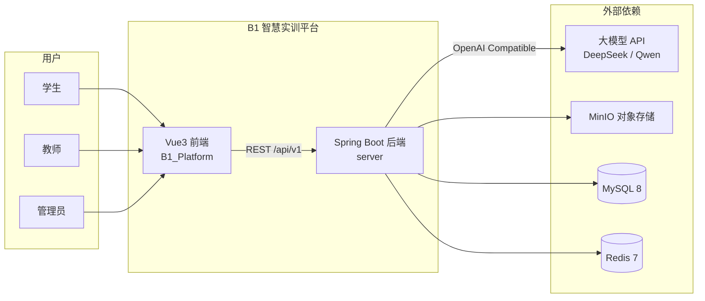
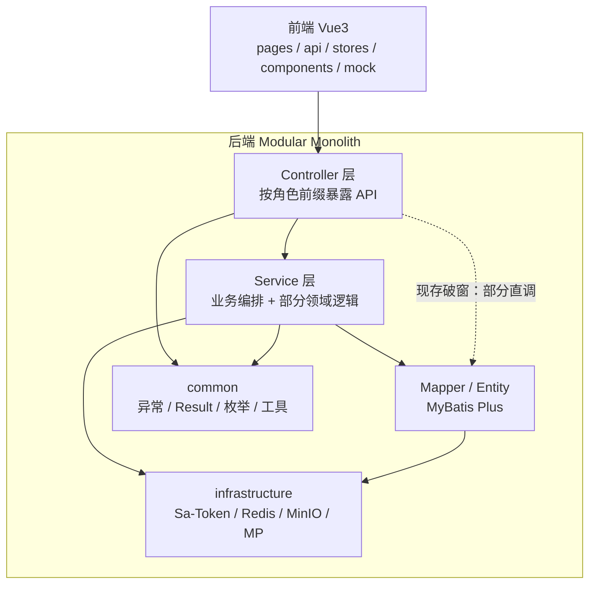
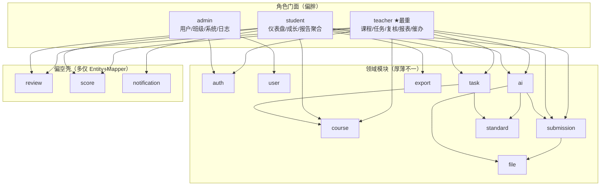
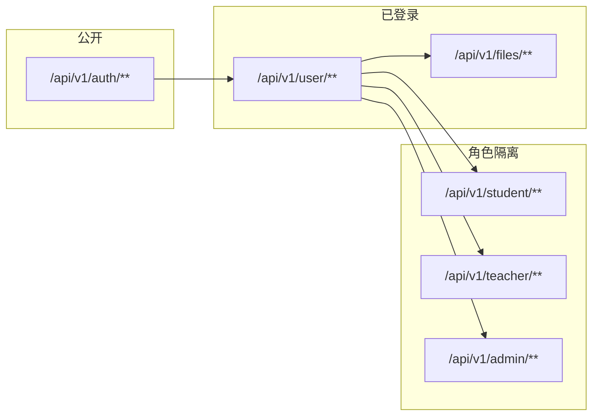
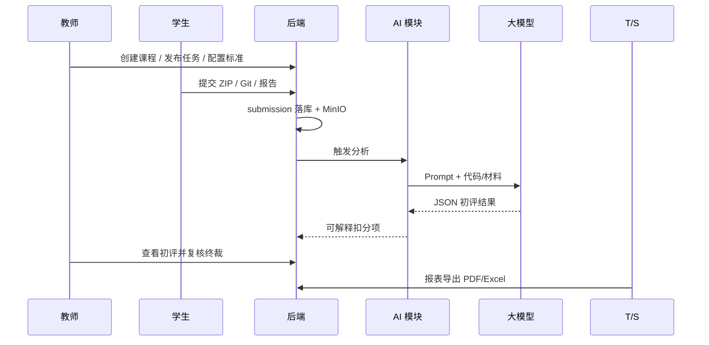
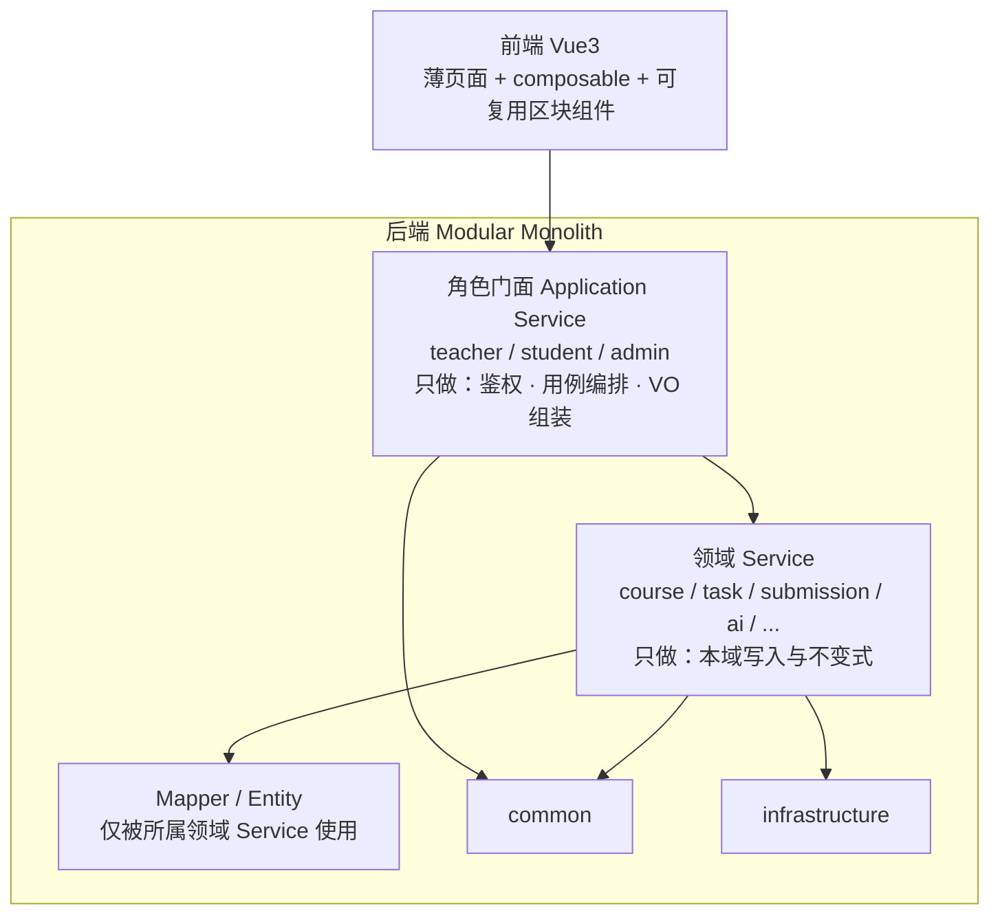
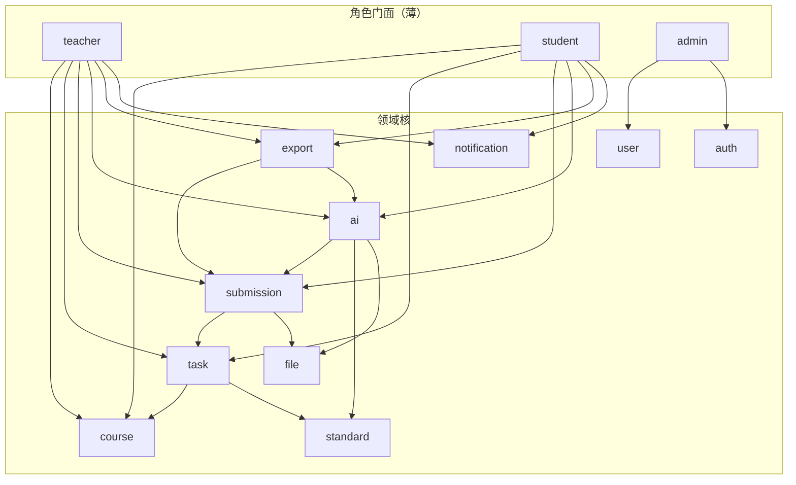
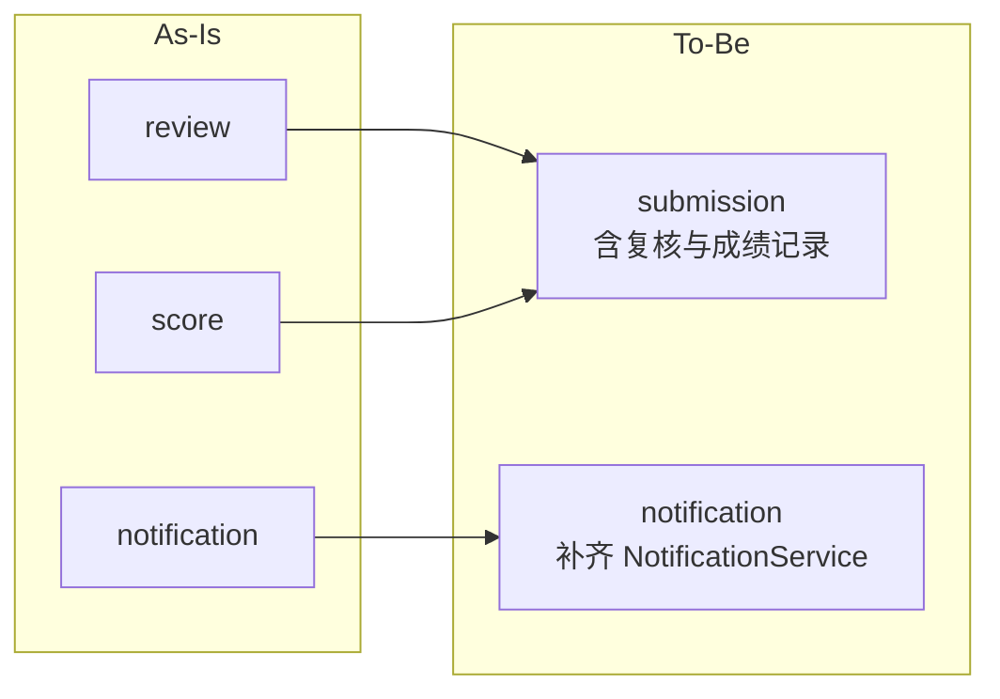
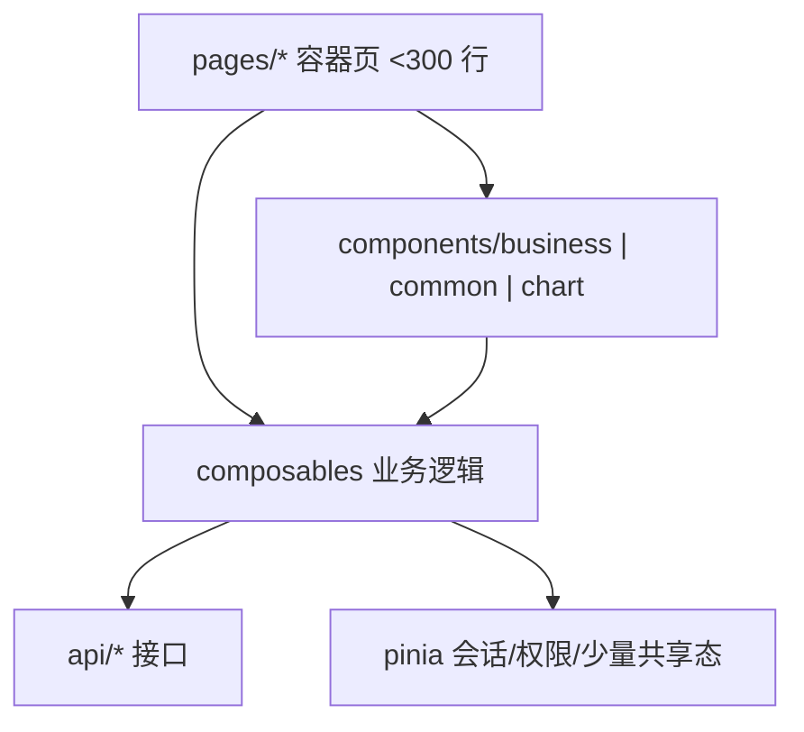
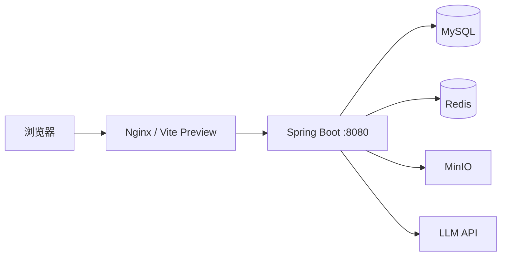

# B1 平台架构图（As-Is / To-Be）

| 项 | 值 |
|---|---|
| 日期 | 2026-08-03 |
| 状态 | 诊断用 / 可作软著说明书附图底稿 |
| 架构模式 | Modular Monolith（模块化单体） |
| 说明 | As-Is 按当前代码整理；To-Be 为冲 8.5+ 的小改目标，非微服务拆分 |

---

## 1. 系统上下文（Context）

---

## 2. As-Is：当前真实架构

### 2.1 逻辑分层

### 2.2 后端模块全景（按代码包）

### 2.3 API 前缀与角色（As-Is，保持）

### 2.4 核心业务链路（As-Is）

### 2.5 As-Is 问题标注

| 问题 | 表现 |
|---|---|
| 双轴划分 | 领域包 + 角色包并存，逻辑多沉在 teacher/student |
| 空壳模块 | review / score / notification 缺少完整 Service 边界 |
| 分层破窗 | 部分 Controller 直接注入多模块 Mapper |
| 文档漂移 | 基线模块名与代码包名不一致 |
| 可验证性弱 | 自动化测试几乎为 0 |

---

## 3. To-Be：冲 8.5+ 目标架构（小改）

原则：**不拆微服务、不换栈**；门面变薄、领域变实、分层变严、测试补齐。

### 3.1 目标逻辑分层

### 3.2 目标模块依赖（允许方向）

### 3.3 空壳模块归并建议

> 若不想立刻改包名：可保留 `review`/`score` 包路径，但 **对外只允许经 `submission` Service 访问**，禁止门面直调 Mapper。

### 3.4 前端目标结构（配合架构分）

优先拆分：`LoginPage` / `SubmitPage` / `AIResultPage` / `SubmissionsPage`。

### 3.5 部署拓扑（软著主叙事，不含国产化）

麒麟 + LoongArch 相关降级为归档附录，不进入主架构图。

---

## 4. As-Is vs To-Be 对照

| 维度 | As-Is | To-Be |
|---|---|---|
| 模式 | 模块化单体 | 同左（不变） |
| 模块轴 | 领域 + 角色混杂，角色偏胖 | 领域核实、角色门面薄 |
| 分层 | 部分 Controller→Mapper | 严格 Facade→Domain→Mapper |
| review/score | 空壳 | 归入 submission 边界 |
| notification | 空壳 | 独立 Service |
| 测试 | 近乎 0 | 主闭环自动化 |
| 文档 | 与代码漂移 | 以本图为准同步基线 |
| 部署 | 含竞赛国产化叙事 | 标准 Docker 为主 |

---

## 5. 软著说明书建议用法

1. **系统结构**：用 §1 上下文图 + §3.1 分层图  
2. **功能模块**：用 §3.2 模块依赖图（比 As-Is 更清晰，也代表优化目标）  
3. **若材料需反映现状**：可附 §2 As-Is，并注明「实现优化中」  

当前若立刻截源码申请，说明书模块名务必与 **现有包名** 一致，避免写基线里已过时的 `training/report/system`。
